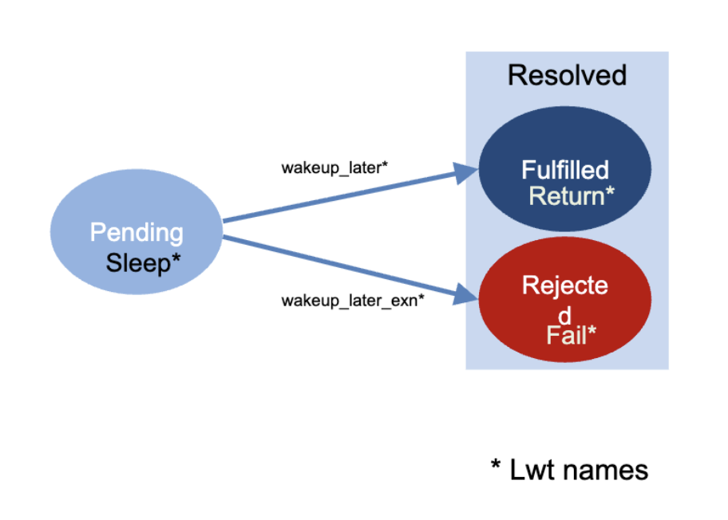
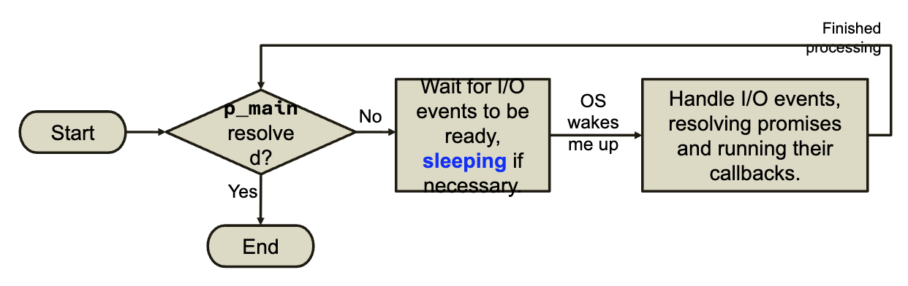

# Lwt

The OCaml library for promises and concurrency, "lightweight threads" with a HORRIBLE name
(they aren't threads)

| Promise name | Lwt name |
| --- | --- |
| `Promise.promise` | `Lwt.t`
| `Promise.resolver` | `Lwt.u`
| `Promise.make` | `Lwt.wait` 
| `Promise.fufill` | `Lwt.wakeup_later`
| `Promise.reject` | `Lwt.wakeup_later_exn`
| `Promise.Pending` | `Lwt.Sleep 
| `Promise.Fulfilled` | `Lwt.Return`
| `Promise.Rejected` | `Lwt.Fail`

State Transitions:


**Remember:**
```ocaml 
type 'a state = Pending | Fulfilled of 'a | Rejected of exn
```

Typical use of `Lwt` is to do concurrent I/O:
- Program launches aysynchronous I/O operations as promises
- Operating system helps to resolve promise

:::note
Source of parellism: hardware
Concurrency managed by: OS and `Lwt`
:::

## Operating Systems and I/O

Your program never touches the hardware directly.

So the OS has to help move bytes acorss the hardware/software boundary
- **Terminal input:** Keyboard -> OS -> Program
- **File Output:** Program -> OS -> Disk

Your program asks OS to move bytes by making **system calls** to functions provided by OS API
- "Disk, network, terminal, etc." all treated the same in API
- "Everything is a file"

### Channels
A **channel** is a *unidirectional stream* of bytes *mediated* by the OS between a 
program and I/O device
- *Unidirectional*: program -> device -> program
- *Stream*: accepts/delivers data in order, like water through a Principles
- *Mediated*: use system calls to ask OS to open, read, write, close_in

OCaml channel interface: **input**

```ocaml 
type in_channel 

val open_in : string -> in_channel
(** Open file for reading *)

val input_line : in_channel -> string
(** Read from channel until newline *)

val close_in : in_channel -> unit
(** Close channel *)
```

OCaml channel interface: **output**

```ocaml 
type out_channel

val open_out : string -> out_channel
(** Open file for writing *)

val output_string : out_channel -> string -> unit
(** Write string to channel *)

val close_out : out_channel -> unit
(** Close channel *)
```

:::info 
Programs "block" during synchronous I/O
:::

**Block**: as in, an obstacle to forward progress
- Synchronous I/O functions involving channels *can block and not return until operation completes*
    - `input_line : in_channel -> string`: May block until the channel delivers a sequence of bytes
    ending with newline (or EOF)
    - `read_line : unit -> string`: May block until `stdin` does the same - usually meaning the user enters 
    an input and presses return key 

**But concurrent programs don't always want to wait**

:::note 
Aysynchronous I/O is "non-blocking"
:::

## Aysynchronous I/O with Promises

`Lwt` I/O functions return *promises*

```ocaml 
Stdlib.input_line : in_channel -> string

Lwt_io.read_line : input_channel -> string Lwt.t
(* Returns a PROMISE of a string *)
```

For example, with non-blocking

```ocaml 
let p_str = 
    Lwt.io.(read_line stdin) in 
    (* rest of program *)
```

Call to `read_line` does not block:
- *Program execution immeditely continues* while OS works on getting
input in parallel
- Meanwhile `p_str` is bound to a promise
- And the rest of the program is *already* executing
- The input operation completes aysynchronous

But how do we **use** a promised input? What can we do when the program needs the string
from inside the promise

## Using Promises

There are two ways to use promises

1. **Wait**: Decide that there is one main promise you need, and tell `Lwt`: when that promise
is resolved, you want the result
    - Other promises might also be involved and helping to do the computation. Some might have to complete,
    others might not
2. **Schedule**: Decide that when a give promise is fulfilled, you already know what work you want to do with the result.
Give `Lwt` a function that it can run on your behalf later to do that work

### Wait 

Use the `run` function

```ocaml
Lwt_main.run: 'a Lwt.t -> 'a 
```
Call `eun` from your program to start `Lwt` **main loop** aka **scheduler**
- `run p` will not return until `p` is resolved
    - Meanwhile control of execution belongs to `Lwt`, which will work together with the OS to resolve
    promises
    - When `p` is resolved, `run` returns the fulfilled value `p` contains
    - Or if `p` is rejected, `run` raises the execption `p` cintains

### Schedule

Use the `map` function

```ocaml 
val map: ('a -> 'b) -> 'a Lwt.t -> 'b Lwt.t 
(** [map f p] schedules callback [f] to run after [p] is fulfilled *)
```

**Callback:** as in, "call me back when you have the answer"

`map` basically says that callback will run eventually, and it returns a **new** fulfilled promise 

So when the program calls `map f p1`:
- `map` creates a new pending promise `p2`
- `map` tells `p1` "When you get resolved here's a callback `f` to run: Put the result in
`p2`
- `map` then returns `p2` immediately

## Lwt Main Loop

```ocaml 
val Lwt_main.run : 'a Lwt.t -> 'a 
(** [run p_main] runs the main loop (aka scheduler) until [p_main] resolves *)
```



:::note
**Only one callback executes at a time.** While a callback is executing, the main loop stays within the handle
I/O events stage *until the callback returns**
:::

A **cascade effect** may occure: running a callback resolve another promise which then

That being said, callback code still executes sequentially. 

## Lwt.both

```ocaml 
val both: 'a Lwt.t -> 'b Lwt.t -> ('a * 'b) Lwt.t 
(** [both p1 p2] returns a promise that is fulfilled when both input promises are fulfilled *)
```

A pair will be created once the two specified promises are fulfilled

When the program calls `both p1 p2`:
- `both` creates a new pending promise `p3`
- `both` tells the **main loop** "schedule a callback to run when both `p1` and `p2`
are resolved and put the callback's result in `p3`
- `both` the returns `p3` immediately

## Lwt.bind 

```ocaml 
val bind: 'a Lwt.t -> ('a -> 'b Lwt.t) -> 'b Lwt.t 
(** [bind p f] schedules a callback [f] to run after [p] is fulfilled. 
The promise returned by [bind] will have the same outcome as the promise returned by [f]*)
```

:::info
The difference between `bind` and `map` is that `bind` takes in a callback function that returns 
*another* promise
:::

## Lwt.return

```ocaml 
val return : 'a -> 'a Lwt.t
(** Returns an already fulfilled promise with given value *)
```

### Alternate Syntax

```ocaml 
lwt%lwt x = p in e
(** bind x to the fulfilled value inside of p, then evaluate e*)
```

## Handlers and Proxies

In order to schedule a callback to run on the promise and put the result into a new one,
we need two new ideas

**Handlers:** Remember what to do later
- Store a function on a pending promise
- When the promise resolves, run it with the value or exception

**Proxies:** Share an outcome
- Make one promise refer to another
- Both promises then observe the same result

**This links the promises returned by `bind` and its callback**


