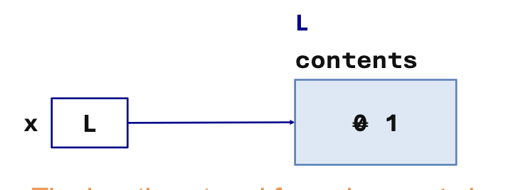

# Mutable Fields

Example:

```ocaml 
type counter = {
    step: int 
    mutable count : int
}

let c = {step = 2; count = 0}

c.count <- c.count + c.step
(* The count is mutated to 2 *)

c.step <- 1
( *Type checking error: The record field step is not mutable *)
```

## Memory representation

In the example `c` is bound to a record's location. This binding is immutable and the contents of `c` cannot change

Records are stored in a **block** of memory. Fields are in the same order as type declarations with `O(1)` access to each field.

## References

Example:
```ocaml 
type 'a var = {mutable contents: 'a}
```

:::info 
The location stored for `x` does not change. The `contents` field at location L does.
:::

So if:
```ocaml 
type 'a var = {mutable contents : 'a}
let x = {contents = 0} in
x.contents <- x.contents + 1;
x.contents
- : int = 1
```

It will look something like this:



In OCaml, this is called a **reference**. In the standard-library
it will look something like this:

```ocaml 
type 'a ref = {
    mutable: contents: 'a
}
```

It is important to note that:
- The `let` binding of the indentifier to the pointer in memory: **immutable**
- The *contents* of the memory location: mutable
- The type of the contents: immutable

| Syntax | Purpose | Implementation | 
| --- | --- | --- |
| `ref e` | Create a new mutable reference | `{contents = e}` |
| `!e` | Get the contents of the reference | `e.contents` |
| `e1 := e2` | Mutable assignment to a reference | `e1.contents <- e2` |

## Equality 

| Expression | Result | What it compares  | 
| --- | --- | --- |
| `r1 = r2` | `true` | If the contents are the same  |
| `r1 == r2` | `false` | If L1 and L2 have different locations in memory |
| `r1 == r3` | `true` | If both expressions point to the same location in memory |


