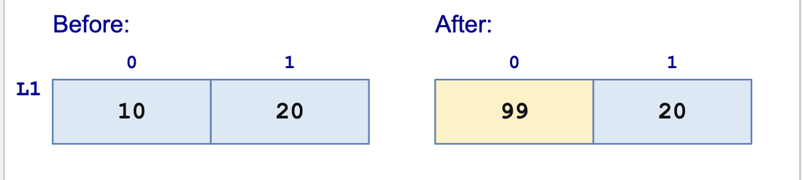
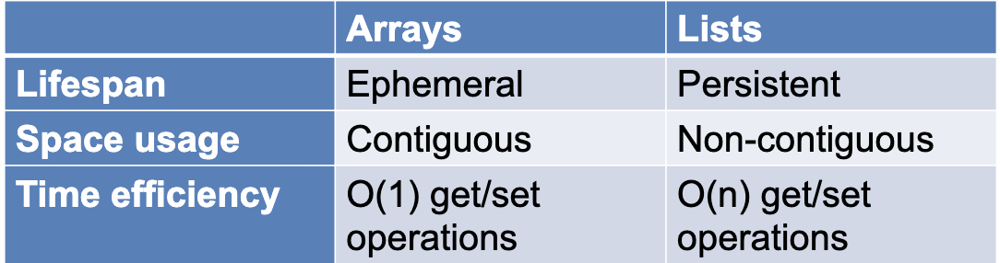

# Mutability in OCaml

Althought mutable data structures can be more **efficient**, it can also
be harder to program with them
- Calling the same function with the same arguments can produce different results
- Calling a function can change values of vairables that you know nothing about
- Aliasing reppears as a challenge

## Arrays

Syntax
```OCaml
let a = [|10; 20|];;
a.(0) <- 99
```

- `[|...|]` creates an array
- `a.(i)` accesses element `i`
- `<-` updates an element in place

### Semantics 
The expression `a.(0) <- 99` has type `unit ()`

For our array which contains `[|10; 20|]`, say it has a location in memory 
`L1`, within this address, the value at index `0` will be mutated to now have a value
`99`



### Locations
Imperative data structures generally manipulate Locations

- **Array literal**: `[|x1; x2; ...; xn|]` allocates contiguous memory for **n** array elements
, initlizaes them to `x1...xn` and returns the ***location of the array***
- **Array creation**: `Array.make n d` allocates contiguous memory for **n** array elements, initializes each to 
a defualt value `d` and ***returns the location of the array***

:::info
Locations are **values**
:::

### Memory Safety 
OCaml lets us use locations but not necessarily "create" them
- Allocation produces valid locations. We can store and share them.
- We cannot turn an arbitrary integer into a location or use pointer arithmetic
to access neighboring memory

**OCaml is NOT like C**

:::warning
Memory-safe does not mean bug-free
:::
- Aliasing can still make us update data we didn't intend to change
- But an out-of-bounds write cannot corrupt an unrelated object

### Arrays vs. Lists



**Ephemeral**: means updates that are in place and destroy previous copies of the listing
**Persistent:** means preserving all previous versions of the list

:::info
Because lists in OCaml are essentially linked lists, it takes `O(n)` time for
reads/writes 
:::

| | Code |
| --- | --- |
| Type | `'a array`|
| Literal | `[|e1; e2; ...; en|]`|
| Get | `e1.(e2)` also `Array.get`
| Set | `e1.(e2) <- e3` also `Array.set`
| Creation | `Array.make: int -> 'a -> 'a array`
| Length | `Array.length: 'a array -> int`

## Semicolon Operator

Syntax: `e1; e2`

Semicolon is a statement **separator**, not a terminator

Multiple Semicolons are right associative:
`e1; e2; ...; en` means `e1; (e2; (...; en))`

:::info 
This means `en` gets evaluated **first**
:::

**Semicolons are essentially a `let`

```ocaml 
e1; e2
(* means almost the same as *)
let () = e1 in e2
```

**EXCEPT**: if `e1` does not have type `unit`:
- `let` gives a *type error*
- `;` gives a *type warning*

## Loops

```ocaml 
for x = e1 to e2 do e3 done 
for x = e1 downto e2 do e3 done
while e1 do e2 done
```

**Dynamic Semantics**: for: evaluate bounds once, step by +1 (to) or -1 (downto), inclusively.
while: recheck the condition in the current memory before each iteration.

**Static Semantics**: for: integer bounds, x : int. while: a bool condition.
Bodies should have type unit. Both loops have type unit. 


